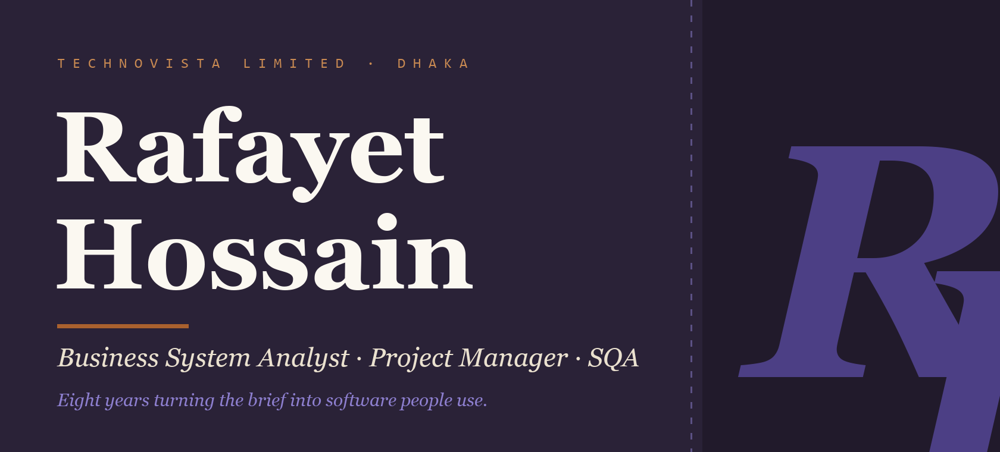

	

<strong>I take the brief as it comes. I ask the questions nobody else does.</strong>

<a href="https://rafayethossain.github.io/portfolio/">Portfolio</a> &nbsp;·&nbsp; <a href="https://www.linkedin.com/in/rafayethossain/">LinkedIn</a> &nbsp;·&nbsp; <a href="https://github.com/rafayethossain">GitHub</a> &nbsp;·&nbsp; <a href="https://rafayethossain.medium.com/">Medium</a> &nbsp;·&nbsp; <a href="mailto:rafayet14@gmail.com">Email</a>

## About

Eight years in the same place: the business says one thing, the engineering team builds another, and the shipped thing goes unused. That handoff is my work.

I pull the real problem out of the room, write it down so an engineer can build from it and a manager can sign it off, then stay close through testing and rollout until *“done”* means *“used.”*

My degree is in Computer Science &amp; Engineering, and my first job was as a software engineer. That order matters — I have been the developer who received the vague ticket, so now I write requirements the way I want to receive them.

Since 2018, at TechnoVista Limited, across garments, government, broadcast and international development. Lean Six Sigma Black Belt: a formal way of saying I don't trust a process until I've measured it.

## How I work

- **Requirements before solutions.** The question nobody asks decides the project.
- **Write it, then make it testable.** If it can't be tested, it isn't defined.
- **Stay for adoption.** Go-live is not the finish line; training and review are.
- **Keep the scope honest.** Trade-offs surface early, not after the budget burns.

## Selected work

| Project | What it is | Scale |
|---|---|---|
| **Vista.Q** | Quality monitoring system for RMG factories | 12 modules · 170k+ pieces/day · 8 factories |
| **Eco-Tourism Sundarban** | Digitized visitor management &amp; ticketing — live public portal | Bangladesh Forest Department |
| **Integrated Online Application System** | HR, leave, payroll, fleet &amp; approvals in one system | CARE Bangladesh · 500+ staff |
| **Tottho Apa MIS (Phase II)** | Women's empowerment MIS across information centres | 492 centres · 6M beneficiaries |
| **Broadcast Management System** | Scheduling, content &amp; ad placement for a TV channel | Media · UAT with daily live crew |

## Writing

About the parts of projects that get skipped — communication, requirements, keeping a plan honest.

[Agile Scrum, from the pillars to the artifacts →](https://rafayethossain.medium.com/) &nbsp;·&nbsp; [Stakeholder communication →](https://rafayethossain.medium.com/) &nbsp;·&nbsp; [Talks &amp; walkthroughs on YouTube →](https://www.youtube.com/channel/UCsTNdhx0etbm-571LVTCW2g/featured)

<em>“The best analysts I've seen never stop being a little bit technical.”</em>

Rafayet Hossain &nbsp;·&nbsp; TechnoVista Limited &nbsp;·&nbsp; Dhaka, Bangladesh &nbsp;·&nbsp; Last updated November 2026

